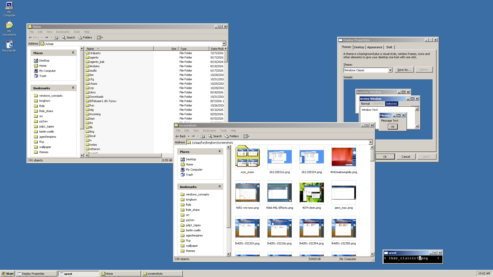
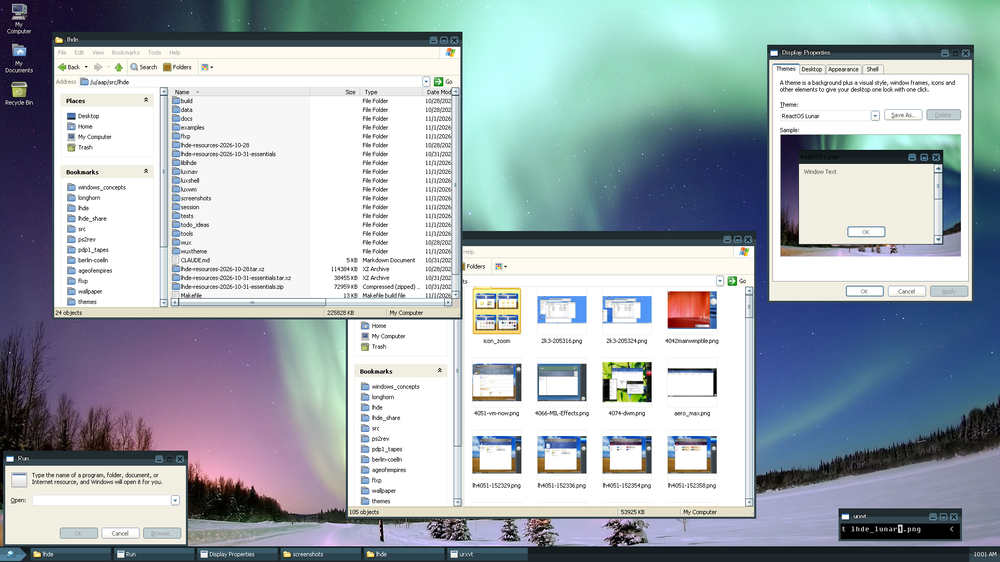
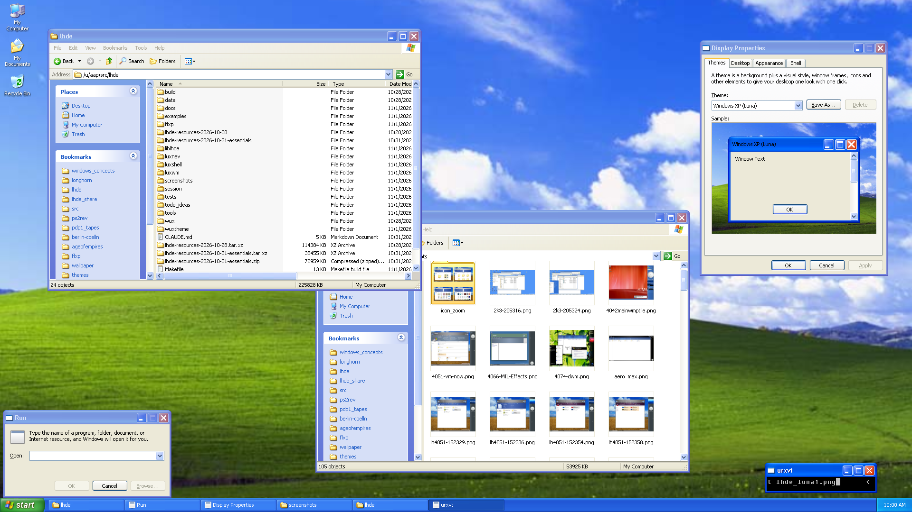
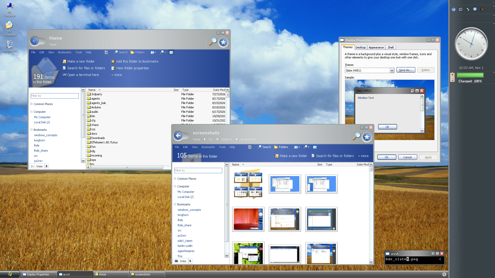
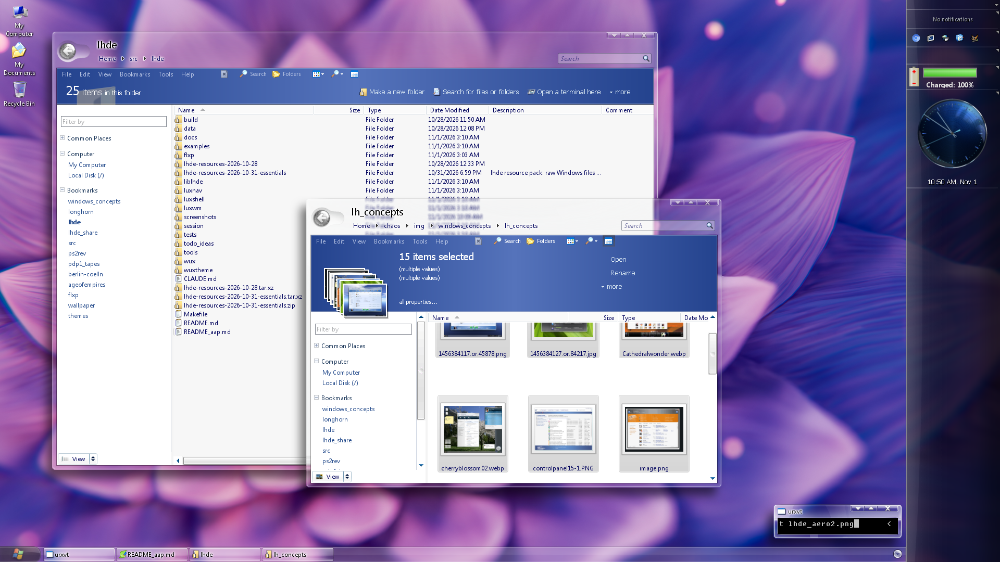
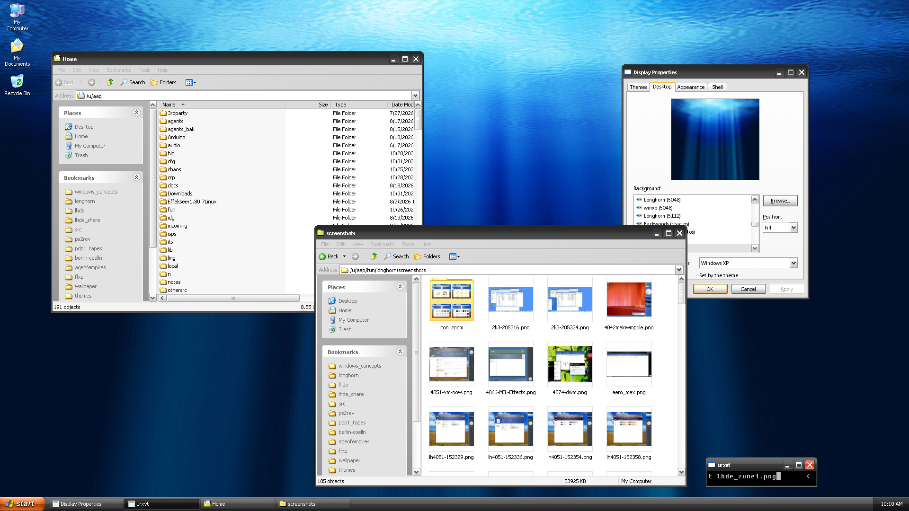

# lhde - a Longhorn desktop for X11

WIP

## The idea

I wanted an accurate Windows Explorer for Linux.
This endeavour spiraled into an actually usable native Windows-like desktop for X11,
and a the same time a rather complete UI museum of Windows up to Longhorn.

The Win32 UI core comes from the Wine and ReactOS projects,
a team of Claude agents (Fable, Opus, Sonnet) did the actual engineering and reverse engineering,
under my chaotic supervision. Code review and feedback from GPT Astra.

## Screenshots

Free themes (ReactOS's styles and Windows Classic, nothing imported from Windows):

Some of the Windows themes, with the user's own resources imported:

## Install & Run

The short version; [docs/BUILDING.md](docs/BUILDING.md) has the long one (every prerequisite, what `make` builds and
installs, the three trees) and [docs/USAGE.md](docs/USAGE.md) is the user guide.

    make -j                                  everything into build/ (runs uninstalled from there too)
    make check                               the tests (Xvfb, xdotool, ImageMagick; each skips when its tool is missing)
    make install PREFIX=~/.local             or /usr/local; program files only, no Windows file, no setting

The free resources (ReactOS's boot CD, GPL: the fonts, Marlett, the Lunar/Modern/Mizu/Lautus styles, icons) make a complete
desktop without any Microsoft file:

    make install-resources-free LHDE_REACTOS_ISO=ReactOS-0.4.16.iso    into ~/.local/share/lhde-windows

Then a session, from a text console (`startx`, display :1) or nested in a Xephyr window:

    lhde-session start [THEME]               e.g. lunar, classic; Ctrl+C on the console ends it
    lhde-session start --nested [THEME]
    lhde-session theme NAME                  switch live; lhde-theme list shows what is complete

The sidebar's Start, Super+Shift+S for a screenshot (`luxshot`), `flxp DIR` for an explorer window,
`flxp-settings` for Display Properties.

### Installing Windows themes

This repo does not contain original MS resources. The Longhorn and XP themes need the user's own copies: an ISO, a WIM,
an installed Windows directory, or a resource pack made from them with `lhde-pack`. `lhde-import` takes what the recipes in
`share/sources/*.ini` name (visual styles, DLLs for icons and art, fonts, wallpapers) into the Windows tree, and generates
the frame sets and shell images from them:

    lhde-import --iso longhorn4074.iso       (or --wim, --dir, --pack; --list shows what is in the tree)
    make install-resources-windows PACK=lhde_winthemes.zip     a pack made with lhde-pack --zip
    make install-resources-full PACK=lhde_wintheme_full.zip    the free files and the whole pack
    lhde-theme explain aero4074              where every part of a theme comes from, and what is missing

Themes whose style is not imported are hidden from the lists; `lhde-import --style FILE.msstyles NAME` adds a single
style as a theme of its own. docs/USAGE.md "Getting the Windows resources" has the details, docs/LICENSING.md says which
licence covers what.

## About the project

I had always thought the Windows desktop and explorer was a rather good user interface.
For Linux/X11 on the other hand I never found a desktop environment or file manager I liked.
Instead I've been using a minimalistic fvwm config for ~15 years, with occasional use of ROX.

Unfortunately desktop environments only seem to be getting worse (according to my taste),
on Linux as well as on Windows (no clue about OS X).
With a lot of work done by the Wine and ReactOS people to implement a free Windows user and binary interface,
I thought it should be reasonable to recreate the good parts of Windows, at a good point in time (post-XPish),
on the OS I actually use: Linux + X11

Since XP/2003 seems to be the platform-defining era of Windows that most people were more or less happy with,
the initial goal (and still the heart of the project) was flxp, an XP-like file explorer.
Once that was working my curiosity about Windows Longhorn made me ask the Claudes to research its internals.
Then my long-held wish to actually *use* what would have become Windows Longhorn came through,
and I decided to just give it a shot and see how far one could get.
This repo is the result.

## Roadmap

Incomplete, and in no particular order:

* battle test and polish flxp and wux in particular
* experiment with xattrs and WinFS visions
* implement useful sidebar tiles
* more applications:
	* image viewer
	* text editor
	* hex editor
	* calendar
	* ...
* complete UI museum
* wayland port?

## Dependencies

A C and C++17 compiler, GNU make, Python 3, pkg-config with x11, xext, xfixes, xinerama, xft, freetype2, fontconfig,
libpng, libjpeg, dbus-1, cairo, pangocairo and Lua 5.4. At run time picom (composition: the glass frames), feh, xprop,
xsetroot, dbus-daemon, startx or Xephyr. The import needs Python 3 with Pillow, 7z and tar with xz. One `xbps-install`
line for Void Linux and the equivalents for other distributions are in [docs/BUILDING.md](docs/BUILDING.md).
